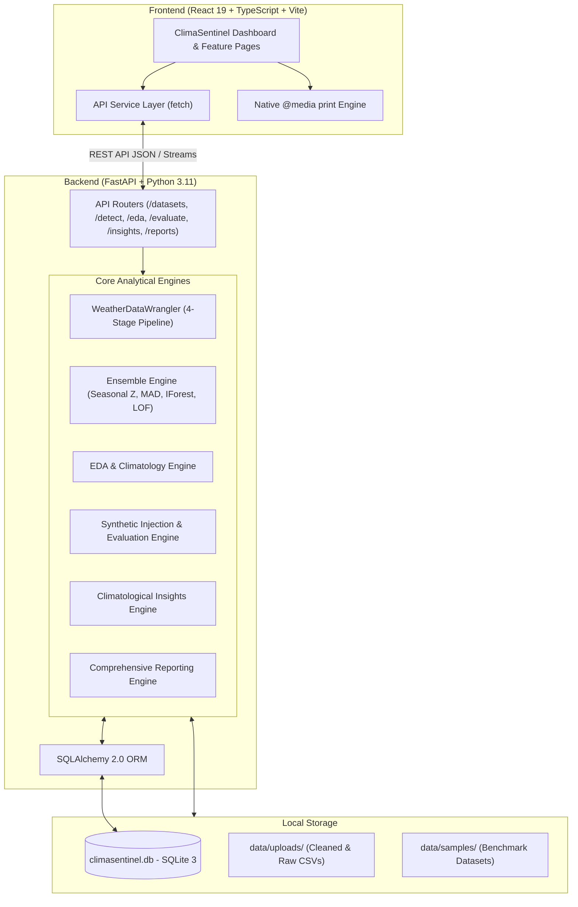

# ClimaSentinel — Weather & Climate Anomaly Detection Platform

An audit-grade, data-driven platform for detecting, corroborating, and analyzing meteorological anomalies in historical and observational climate time series.

> **Academic Project Context:**  
> ClimaSentinel was developed as an academic coursework project in **Data Mining & Data Wrangling**. It demonstrates end-to-end meteorological data ingestion, robust statistical and machine learning anomaly detection, multi-detector consensus ensemble modeling, controlled synthetic benchmarking, and scientific audit reporting.

---

## Table of Contents

- [1. Project Overview](#1-project-overview)
- [2. Key Features](#2-key-features)
- [3. Technology Stack](#3-technology-stack)
- [4. System Architecture](#4-system-architecture)
- [5. Project Structure](#5-project-structure)
- [6. Local Installation & Setup](#6-local-installation--setup)
- [7. Usage Workflow](#7-usage-workflow)
- [8. Detection Methodology](#8-detection-methodology)
- [9. API Overview](#9-api-overview)
- [10. Datasets & Scientific Disclosures](#10-datasets--scientific-disclosures)
- [11. Testing & Verification](#11-testing--verification)
- [12. Limitations & Future Scope](#12-limitations--future-scope)
- [13. Screenshots](#13-screenshots)
- [14. License & Attribution](#14-license--attribution)

---

## 1. Project Overview

### Problem Statement
Meteorological time series present severe challenges for standard anomaly detection systems:
- **Non-Stationarity & Seasonality:** Temperature, humidity, and atmospheric pressure vary dramatically across annual and diurnal cycles. A temperature of $+32^\circ\text{C}$ may represent a normal summer afternoon or a catastrophic winter heat spike.
- **Zero-Inflation & Asymmetry:** Rainfall is episodic, non-negative, and zero-inflated. Standard Gaussian assumptions fail catastrophically on precipitation data.
- **Detector Divergence:** Individual outlier detection algorithms exhibit distinct inductive biases. Tree-based methods (e.g., Isolation Forest) can isolate point extremes but may miss subtle multi-day deviations; density estimators (e.g., LOF) can over-flag sparse seasons; classical Z-scores are vulnerable to masking and non-normal tails.

### Objectives & Motivation
ClimaSentinel addresses these challenges through a unified, reproducible, domain-aware architecture:
1. **Domain-Constrained Wrangling:** Implements a strict **Rainfall Non-Interpolation Policy** ensuring precipitation missingness is never linearly interpolated into fabricated drizzle.
2. **Circular Climatological Baselining:** Computes seasonal baselines using circular Day-of-Year (DOY) moving windows with circular year-boundary wraparound.
3. **Consensus Ensemble Detection:** Combines two statistical algorithms (Seasonal Z-Score, Modified Z-Score / MAD) and two machine learning models (Isolation Forest, Local Outlier Factor) through multi-algorithm voting.
4. **Controlled Synthetic Benchmarking:** Injects parametric point, block, and step anomalies against known ground truth to evaluate detector precision, recall, F1, and detection delays under physical bounds.
5. **Auditable Reporting & Insights:** Synthesizes rule-based meteorological findings with explicit scientific caveats, exporting 10-section research reports to PDF, CSV, and JSON.

---

## 2. Key Features

- **Dataset Ingestion & Profiling:**
  - Automatic column mapping (Date, Temperature, Precipitation, Humidity, Pressure, Wind Speed).
  - World Meteorological Organization (WMO) physical bounds sanity checks.
  - Missingness profiling, duplicate row tracking, and deterministic quality scoring (0–100).
- **Four-Stage Preprocessing & Wrangling:**
  - Monotonic chronological sorting and duplicate timestamp pruning.
  - Continuous variable imputation (Linear interpolation, Forward-fill, Median, or None).
  - Explicit rainfall preservation (`preserve` maintaining raw NaN provenance or `zero_fill`).
  - Rolling lag extraction and meteorological season assignment (DJF, MAM, JJA, SON).
- **Consensus Ensemble Anomaly Detection:**
  - **Seasonal Z-Score:** Deviations relative to 7-day circular DOY moving window baselines.
  - **Modified Z-Score:** Median Absolute Deviation (MAD) resistant to outlier masking.
  - **Isolation Forest:** Tree-based ensemble partitioning for non-linear multivariate extremes.
  - **Local Outlier Factor (LOF):** Local density deviation relative to $k$-nearest neighbors.
  - **Ensemble Voting:** Confirmed ($\ge 2$ votes), Potential ($1$ vote), Normal ($0$ votes).
- **Exploratory Data Analysis (EDA) Suite:**
  - Statistical moments (mean, median, standard deviation, skewness, kurtosis) and histograms.
  - Pearson and Spearman correlation matrices with pairwise sample size tracking.
  - Monthly and seasonal climatology profiles across meteorological quarters.
  - Sub-sampled interactive time-series viewer with rolling 7-day trendlines.
  - Temporal missingness heatmaps by month and variable.
- **Algorithm Comparison & Controlled Benchmarking:**
  - Observational agreement matrices (Jaccard similarity, shared anomaly counts).
  - Controlled synthetic benchmark injection engine supporting Point, Block, and Step perturbations.
  - Automated evaluation: Precision, Recall, F1-score, False Positive Rate, and Event Detection Delay.
- **Data-Driven Climatological Insights:**
  - Synthesized findings categorized by Meteorological, Distribution, Seasonal, Consensus, and Quality.
  - Grounded supporting observational evidence metrics and key date tags.
  - Mandatory scientific caveats preventing ungrounded decadal or synoptic extrapolations.
- **Audit-Grade 10-Section Research Reporting:**
  - Comprehensive summary integrating wrangling logs, detector configurations, and seasonal trends.
  - Preserves nullable rates (`N/A` for unobserved or unresolved variables; `0.0%` for observed zero-rate periods).
  - Direct download exports for structured JSON and multi-section CSV bundles.
  - Native browser print-to-PDF layout with clean `@media print` styling (no third-party PDF dependencies).

---

## 3. Technology Stack

| Layer | Technologies | Purpose |
| :--- | :--- | :--- |
| **Backend** | Python 3.11+, FastAPI, Uvicorn | High-performance asynchronous REST API framework |
| **Data & Scientific** | Pandas, NumPy, SciPy, Scikit-learn | Numerical processing, moving climatologies, robust statistics, ML detectors |
| **Data Persistence** | SQLite 3, SQLAlchemy 2.0, Pydantic v2 | Relational metadata storage, thread-safe sessions, schema validation |
| **Frontend** | React 19, TypeScript, Vite 8 | Reactive single-page user interface with type-safe state management |
| **Styling & Icons** | Tailwind CSS v4, Lucide React | High-contrast dark/light responsive layout, print optimization, icons |
| **Charts & Graphs** | Recharts | Interactive time-series, bar charts, scatter plots, and distribution histograms |
| **Quality & Tests** | Pytest, Oxlint | 87 automated backend unit/integration tests and sub-second frontend static analysis |

---

## 4. System Architecture

ClimaSentinel operates as a local client-server architecture:



### Architecture Highlights
- **Stateless Analytical Engines:** The detection, wrangling, insights, and reporting engines are pure functional modules taking DataFrames and configuration schemas, making them deterministic and testable.
- **Single-Source Relational Persistence:** All run metadata, detector parameters, anomaly records, quality logs, and wrangling summaries are stored in SQLite (`backend/climasentinel.db`).
- **Zero Cloud Leakage:** All computation, database writes, and file exports are executed on `127.0.0.1` without outbound network calls or cloud dependencies.

---

## 5. Project Structure

```text
ClimaSentinel/
├── .gitignore                      # Git exclusion rules (uploads, DBs, venv, node_modules)
├── .env.example                    # Local configuration template
├── README.md                       # Comprehensive project documentation
│
├── backend/
│   ├── climasentinel.db            # Local SQLite database (auto-generated at runtime)
│   ├── pytest.ini                  # Pytest configuration
│   ├── requirements.txt            # Python dependencies
│   │
│   ├── app/
│   │   ├── config.py               # Pydantic Settings & path configurations
│   │   ├── database.py             # SQLAlchemy engine & session dependency
│   │   ├── main.py                 # FastAPI application factory & lifespan handler
│   │   │
│   │   ├── api/                    # API endpoints
│   │   │   ├── datasets.py         # Upload, profile, sample loading, wrangling
│   │   │   ├── detection.py        # Detection execution, runs, anomaly queries, exports
│   │   │   ├── eda.py              # Distributions, correlations, seasonality, missingness
│   │   │   ├── evaluation.py       # Model comparisons & synthetic benchmarks
│   │   │   ├── health.py           # Backend health check endpoints
│   │   │   ├── insights.py         # Automated climatological insights
│   │   │   └── reports.py          # Summary reports & JSON/CSV export bundles
│   │   │
│   │   ├── core/                   # Core computational modules
│   │   │   ├── detectors/          # Seasonal Z, Modified Z, IForest, LOF, Ensemble
│   │   │   ├── eda.py              # Statistical moments & climatology aggregations
│   │   │   ├── evaluation.py       # Observational comparison & Jaccard matrices
│   │   │   ├── feature_engineering.py # Rolling lags, differentials, season encodings
│   │   │   ├── insights.py         # Rule-based insight synthesis
│   │   │   ├── open_meteo.py       # Open-Meteo archive API client
│   │   │   ├── preprocessor.py     # 4-stage data wrangling & imputation engine
│   │   │   ├── profiler.py         # Column profiling & WMO bounds checking
│   │   │   ├── reporting.py        # 10-section audit report generation & export
│   │   │   ├── seasonal.py         # Circular DOY baselining
│   │   │   ├── synthetic_injection.py # Parametric point/block/step injection
│   │   │   └── validator.py        # Schema detection & physical bounds
│   │   │
│   │   ├── models/                 # SQLAlchemy ORM models
│   │   │   └── dataset.py          # Dataset, Profile, WrangleSummary, Run, Anomaly
│   │   │
│   │   └── schemas/                # Pydantic schemas (Request/Response contracts)
│   │       ├── anomaly.py
│   │       ├── dataset.py
│   │       ├── eda.py
│   │       ├── evaluation.py
│   │       ├── health.py
│   │       ├── insights.py
│   │       ├── reporting.py
│   │       └── wrangling.py
│   │
│   ├── data/
│   │   ├── samples/                # Built-in benchmark datasets
│   │   │   ├── delhi_daily_climate.csv
│   │   │   └── seattle_weather.csv
│   │   └── uploads/                # Runtime uploads (.gitkeep preserved, CSVs ignored)
│   │
│   └── tests/                      # 87 automated test cases
│       ├── test_datasets_api.py
│       ├── test_detection_api.py
│       ├── test_detectors.py
│       ├── test_eda_api.py
│       ├── test_evaluation_api.py
│       ├── test_feature_engineering.py
│       ├── test_health.py
│       ├── test_insights_and_reporting.py
│       ├── test_insights_reports_api.py
│       ├── test_profiler.py
│       ├── test_results_api.py
│       ├── test_seasonal.py
│       └── test_wrangler.py
│
└── frontend/
    ├── index.html                  # HTML5 entry point
    ├── package.json                # Frontend package configuration (v0.1.0)
    ├── vite.config.ts              # Vite config with API proxy (/api -> :8000)
    ├── .oxlintrc.json              # Oxlint static analysis rules
    ├── README.md                   # Frontend client pointer
    │
    └── src/
        ├── App.tsx                 # Root component, routing, global dataset state
        ├── index.css               # Tailwind CSS v4 directives & @media print rules
        ├── main.tsx                # React DOM mount
        │
        ├── components/layout/      # App Header and Sidebar navigation
        ├── hooks/useTheme.ts       # Dark/light theme toggle hook
        ├── services/api.ts         # Centralized API service client
        ├── types/index.ts          # Central TypeScript interfaces
        │
        └── features/               # Functional view components
            ├── anomalies/          # Anomaly Explorer & Inspector
            ├── compare/            # Algorithm Benchmark & Consensus Suite
            ├── dashboard/          # Executive KPI Dashboard
            ├── datasets/           # Dataset Management & Wrangling Runner
            ├── eda/                # Exploratory Data Analysis & Climatology
            ├── insights/           # Climatological Insights & Patterns
            ├── pipeline/           # 4-Stage Wrangling Architecture Viewer
            ├── reports/            # 10-Section Audit Reports & PDF/CSV/JSON Export
            └── settings/           # System status & storage diagnostics
```

---

## 6. Local Installation & Setup

### Prerequisites
- **Python:** 3.11 or higher (`python --version`)
- **Node.js:** v18.0.0 or higher with npm (`node --version`, `npm --version`)
- **Operating System:** Windows, macOS, or Linux (commands below use Windows PowerShell; Unix commands are identical except for virtualenv activation).

---

### Step 1: Clone or Open the Repository
```powershell
cd C:\Users\<YourUser>\Path\To\ClimaSentinel
```

---

### Step 2: Backend Setup & Startup (Terminal 1)

1. Navigate to the backend directory:
   ```powershell
   cd backend
   ```

2. Create and activate a Python virtual environment:
   ```powershell
   # Windows PowerShell:
   python -m venv .venv
   .\.venv\Scripts\Activate.ps1

   # macOS / Linux:
   # python3 -m venv .venv
   # source .venv/bin/activate
   ```

3. Install required Python packages:
   ```powershell
   pip install --upgrade pip
   pip install -r requirements.txt
   ```

4. (Optional) Configure environment variables:
   Copy `.env.example` to `backend/.env` if you wish to override default SQLite paths or CORS origins. The application runs out of the box with sensible defaults.

5. Start the FastAPI development server:
   ```powershell
   uvicorn app.main:app --host 127.0.0.1 --port 8000 --reload
   ```

   - **Backend API Base:** `http://127.0.0.1:8000`
   - **Interactive Swagger Docs:** `http://127.0.0.1:8000/docs`
   - **Health Check Endpoint:** `http://127.0.0.1:8000/api/v1/health`

---

### Step 3: Frontend Setup & Startup (Terminal 2)

1. Open a new terminal and navigate to the `frontend/` directory:
   ```powershell
   cd frontend
   ```

2. Install Node dependencies:
   ```powershell
   npm install
   ```

3. Start the Vite development server:
   ```powershell
   npm run dev
   ```

   - **Frontend Application URL:** `http://localhost:5173`
   - The Vite development server automatically proxies all `/api/*` network requests to `http://127.0.0.1:8000`.

---

## 7. Usage Workflow

```text
[1. Upload / Load Sample] ──> [2. Profile & Wrangle] ──> [3. Run Anomaly Detection]
                                                                  │
         ┌────────────────────────────────────────────────────────┴────────────────────────────────────────┐
         ▼                                                        ▼                                        ▼
[4. Explore Anomalies]                                   [5. Model Benchmark]                     [6. Insights & Reports]
 - Confirmed / Potential filters                          - Cross-detector Jaccard matrix          - 5-category findings
 - Severity badges & deviations                           - Synthetic parametric injection         - 10-section audit report
 - Timeline distribution charts                           - Precision / Recall / F1 scores         - Print PDF & CSV/JSON export
```

1. **Dataset Selection & Ingestion:**
   - Navigate to **Datasets**. Click **"Load Delhi Daily Climate"** or **"Load Seattle Weather"** to instantly ingest built-in benchmarks, or upload your own meteorological CSV.
2. **Quality Wrangling & Imputation:**
   - In **Datasets**, click **"Wrangle"** to open the interactive cleaning modal. Select your continuous imputation method (e.g., Linear) and rainfall policy (`preserve` or `zero_fill`). View the before/after records and generated quality score.
3. **Run Ensemble Detection:**
   - Navigate to **Anomalies**. Configure your hyperparameters (Z-score threshold $\pm 3.0\sigma$, MAD threshold $3.0$, IForest contamination $3\%$, LOF contamination $3\%$) and click **"Run Anomaly Detection"**.
4. **Inspect Findings & Timelines:**
   - Explore identified anomalies filtered by classification (*Confirmed*, *Potential*), severity (*Extreme*, *High*, *Moderate*), and flagging detectors. Click any record to inspect expected baselines and deviations.
5. **Analyze Climatology (EDA):**
   - Navigate to **EDA Profiling** to inspect distribution moments, skewness, kurtosis, correlation heatmaps, 7-day rolling trends, and temporal sensor missingness.
6. **Benchmark Detectors:**
   - Navigate to **Algorithm Bench** to evaluate pairwise detector agreement (Jaccard similarity). Switch to the **Synthetic Benchmark** tab to inject controlled anomalies and measure empirical F1, precision, and recall.
7. **Synthesize Insights & Export Reports:**
   - View categorized findings in **Insights**.
   - Navigate to **Reports & Export** to review the comprehensive 10-section audit summary. Use **"Export JSON"** or **"Export CSV"** for structured data, or click **"Print / Save PDF"** for clean academic reporting.

---

## 8. Detection Methodology

### 1. Seasonal Z-Score (Circ-DOY Window)
Computes a station-relative statistical baseline using a 7-day circular moving window centered on each calendar Day-of-Year (DOY $\in [1, 365]$). Year boundaries ($365 \leftrightarrow 1$) wrap around circularly.
$$\mu_{\text{season}}(d) = \frac{1}{|W(d)|} \sum_{i \in W(d)} x_i, \quad \sigma_{\text{season}}(d) = \sqrt{\frac{1}{|W(d)|-1} \sum_{i \in W(d)} (x_i - \mu_{\text{season}}(d))^2}$$
$$Z(t) = \frac{x(t) - \mu_{\text{season}}(d(t))}{\sigma_{\text{season}}(d(t))}$$
A point is flagged when $|Z(t)| \ge \theta_Z$ (default: $3.0\sigma$).

### 2. Modified Z-Score (Median Absolute Deviation)
Protects against outlier masking where extreme events inflate the standard deviation:
$$\text{MAD}(d) = \text{median}\left( |x_i - \text{median}(x_{W(d)})| \right)$$
$$M_Z(t) = \frac{0.6745 \cdot (x(t) - \text{median}(x_{W(d)}))}{\text{MAD}(d)}$$
A point is flagged when $|M_Z(t)| \ge \theta_{\text{MAD}}$ (default: $3.0$).

### 3. Isolation Forest
An unsupervised ensemble of decision trees that isolates anomalies by randomly selecting a feature and a split value. Anomalies have shorter path lengths $h(x)$ from root to leaf:
$$s(x, n) = 2^{-\frac{E(h(x))}{c(n)}}$$
Flagged when anomaly score $s(x, n)$ falls into the top contamination percentile (default: $3\%$).

### 4. Local Outlier Factor (LOF)
Measures the local density of an observation relative to its $k$-nearest neighbors ($k=20$). Flags points located in substantially sparser neighborhoods than their neighbors.

### Ensemble Consensus Voting
Individual detector outputs are combined into a robust consensus classification:
- **Confirmed Anomaly ($\ge 2$ votes):** Independent algorithms corroborate the departure.
- **Potential Anomaly ($1$ vote):** Flagged by only one algorithm (solo flag). Requires domain verification.
- **Normal ($0$ votes):** Agrees with historical climatology.

---

## 9. API Overview

The backend exposes a versioned REST API (`/api/v1`) with full OpenAPI documentation available at `http://127.0.0.1:8000/docs`:

| Tag | Method | Endpoint | Description |
| :--- | :--- | :--- | :--- |
| **Health** | `GET` | `/api/v1/health` | System status, database connection, server timestamp |
| **Datasets** | `POST` | `/api/v1/datasets/upload` | Upload meteorological CSV file with automatic column detection |
| | `POST` | `/api/v1/datasets/sample/{sample_name}` | Load built-in sample dataset (`delhi_daily_climate`, `seattle_weather`) |
| | `GET` | `/api/v1/datasets` | List all registered datasets with row and column counts |
| | `GET` | `/api/v1/datasets/{id}` | Retrieve specific dataset metadata and status |
| | `DELETE` | `/api/v1/datasets/{id}` | Delete dataset, profiles, wrangling logs, and runs (cascade) |
| | `GET` | `/api/v1/datasets/{id}/profile` | Generate or retrieve WMO statistical profile |
| | `POST` | `/api/v1/datasets/{id}/wrangle` | Execute 4-stage data wrangling and cleaning pipeline |
| | `GET` | `/api/v1/datasets/{id}/quality-summary` | Retrieve data quality score and operations audit log |
| **Detection** | `POST` | `/api/v1/datasets/{id}/detect` | Run 4-model ensemble anomaly detection |
| | `GET` | `/api/v1/datasets/{id}/runs` | List historical anomaly detection runs |
| | `GET` | `/api/v1/datasets/{id}/runs/{run_id}` | Retrieve configuration and summary for a specific run |
| | `DELETE` | `/api/v1/datasets/{id}/runs/{run_id}` | Delete a specific detection run |
| | `GET` | `/api/v1/datasets/{id}/anomalies` | Query anomalies with filtering (classification, severity, detector, dates) |
| | `GET` | `/api/v1/datasets/{id}/anomalies/summary` | Summary counts, severity breakdown, and detector agreement |
| | `GET` | `/api/v1/datasets/{id}/anomalies/timeline` | Monthly or yearly anomaly aggregation buckets |
| | `GET` | `/api/v1/datasets/{id}/anomalies/export` | Download filtered anomalies as CSV or JSON |
| **EDA** | `GET` | `/api/v1/datasets/{id}/eda/distribution` | Distribution statistics, moments, and histogram bins |
| | `GET` | `/api/v1/datasets/{id}/eda/correlations` | Pearson & Spearman correlation matrices with sample sizes |
| | `GET` | `/api/v1/datasets/{id}/eda/seasonality` | Monthly and seasonal climatology profiles across quarters |
| | `GET` | `/api/v1/datasets/{id}/eda/timeseries` | Sub-sampled time series with rolling 7-day trendlines |
| | `GET` | `/api/v1/datasets/{id}/eda/missingness` | Temporal missingness cell grid by month and variable |
| **Evaluation** | `GET` | `/api/v1/datasets/{id}/runs/{run_id}/compare` | Cross-detector agreement, Jaccard matrices, solo flag rates |
| | `POST` | `/api/v1/datasets/{id}/evaluate/benchmark` | Run parametric synthetic anomaly benchmark and compute F1/delay |
| **Insights** | `GET` | `/api/v1/datasets/{id}/insights` | Automated rule-derived climatological insights with scientific caveats |
| **Reports** | `GET` | `/api/v1/datasets/{id}/reports/summary` | Generate complete 10-section research and audit report |
| | `GET` | `/api/v1/datasets/{id}/reports/export` | Export report as structured JSON or multi-section CSV bundle |

---

## 10. Datasets & Scientific Disclosures

### 1. Synthetic Benchmark Nature of Sample Datasets
The built-in sample datasets (`delhi_daily_climate.csv` and `seattle_weather.csv`) provided in `backend/data/samples/` are structured benchmarking files intended for algorithm verification and reproducible testing. They **do not** represent certified, official national meteorological agency records (such as IMD or NOAA NCEI official station archives) and must not be used for operational safety decisions.

### 2. Scientific Rainfall Handling Policy
Precipitation is strictly non-negative, zero-inflated, and episodic:
- **Never Interpolated:** ClimaSentinel enforces that rainfall missingness is **never linearly interpolated**. Linear interpolation across dry gaps creates fabricated drizzle, corrupting dry-spell analysis and seasonal totals.
- **Preserve vs. Zero-Fill:** By default (`preserve`), missing rainfall records remain `NaN`, and downstream denominators count only valid observational days. If a user explicitly selects `zero_fill`, missing values are set to $0.0\text{ mm}$ with explicit provenance recorded in the wrangling summary.
- **Distinguishing Missing from Zero:** A recorded rainfall of $0.0\text{ mm}$ represents an observed dry day; a missing observation (`NaN`) represents an unobserved day. The system never equates the two.

### 3. Synthetic Benchmark Evaluation Disclaimer
Synthetic anomaly injection (point spikes, block heatwaves, step drifts) evaluates algorithm sensitivity under controlled mathematical conditions. High precision or recall on synthetic benchmarks **does not** establish real-world meteorological infallibility under complex mesoscale weather systems.

---

## 11. Testing & Verification

The test suite ensures strict mathematical invariance, API safety, rate nullability, and non-regression:

### Backend Test Execution
```powershell
cd backend
.\.venv\Scripts\Activate.ps1
pytest tests/ -v
```
**Current Status:** `87 passed, 1 warning in ~35s` (100% pass rate across 13 test files).

### Frontend Production Build & Linting
```powershell
cd frontend
npm run build   # Type-checks with TypeScript (tsc -b) and builds Vite bundle
npm run lint    # Runs static analysis with Oxlint
```
**Current Status:** Production bundle built in ~4s with **0 errors**. Oxlint reports **0 errors** across all 17 files.

---

## 12. Limitations & Future Scope

### Implemented vs. Future Capabilities

| Capability | Current Implementation Status | Future Scope |
| :--- | :--- | :--- |
| **Spatial Resolution** | Single-station point time series (station-relative). | Gridded spatial fields (e.g. ERA5 reanalysis netCDF4 / GRIB2). |
| **Extreme Value Theory** | Non-parametric empirical cutoffs ($\pm 3.0\sigma$, MAD $\ge 3.0$). | Generalized Pareto Distribution (GPD) and Peaks-Over-Threshold (POT) modeling. |
| **Climatological Baselines** | 7-day circular moving window Day-of-Year (DOY). | 30-year WMO Standard Normal climatology baselines (1991–2020). |
| **Deployment Mode** | Strictly local execution (`127.0.0.1:8000` & `:5173`). | Containerized microservices (Docker Compose) with reverse proxy. |
| **Real-Time Telemetry** | Historical batch CSV processing. | Streaming sensor ingestion via WebSocket or MQTT. |

---

## 13. Screenshots

*To add genuine screenshots of your running instance, launch the application locally, capture screenshots of each view, place them in `docs/screenshots/`, and update the links below:*

| View | Preview Placeholder | Description |
| :--- | :---: | :--- |
| **Dashboard** | `` | Executive summary cards, anomaly breakdown pie charts, and monthly severity distribution |
| **Datasets & Wrangling** | `` | Dataset profiling, WMO bounds checking, and interactive wrangling configuration modal |
| **Anomaly Explorer** | `` | Time-series scatter viewer, confirmed/potential filters, and detailed record inspection modal |
| **EDA & Climatology** | `` | Distribution moments, inter-variable correlation matrix, and seasonal climatology |
| **Algorithm Benchmark** | `` | Pairwise Jaccard overlap matrices and controlled synthetic benchmark confusion matrices |
| **Insights** | `` | Rule-derived findings across 5 categories with supporting evidence metrics and caveats |
| **Audit Reports** | `` | Multi-section research audit report with print-to-PDF formatting and CSV/JSON export |

---

## 14. License & Attribution

- **License:** No license has been specified yet. All rights reserved.
- **Academic Attribution:** Developed as an academic Data Mining and Wrangling project. Sample datasets adapted from open public meteorological benchmarks.

